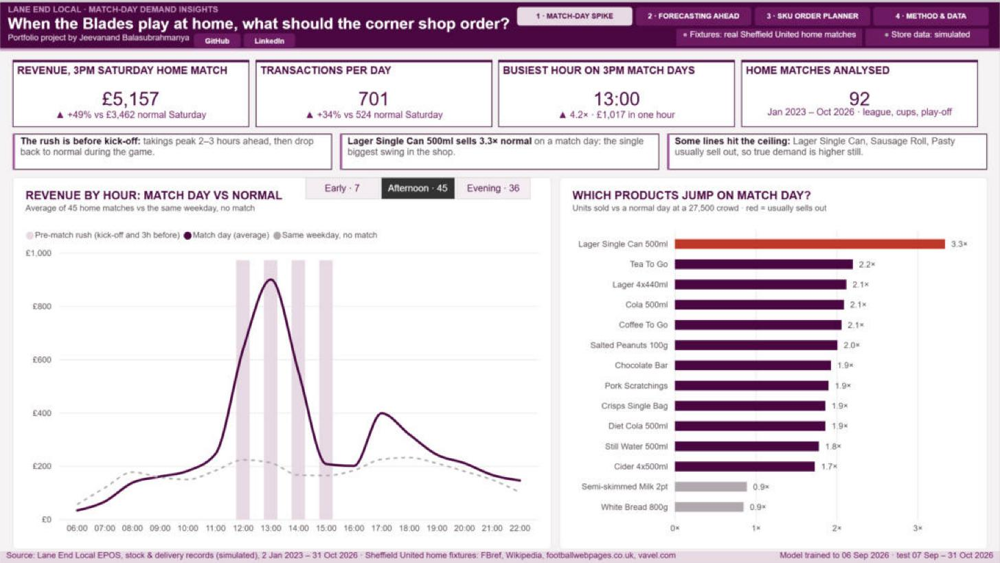
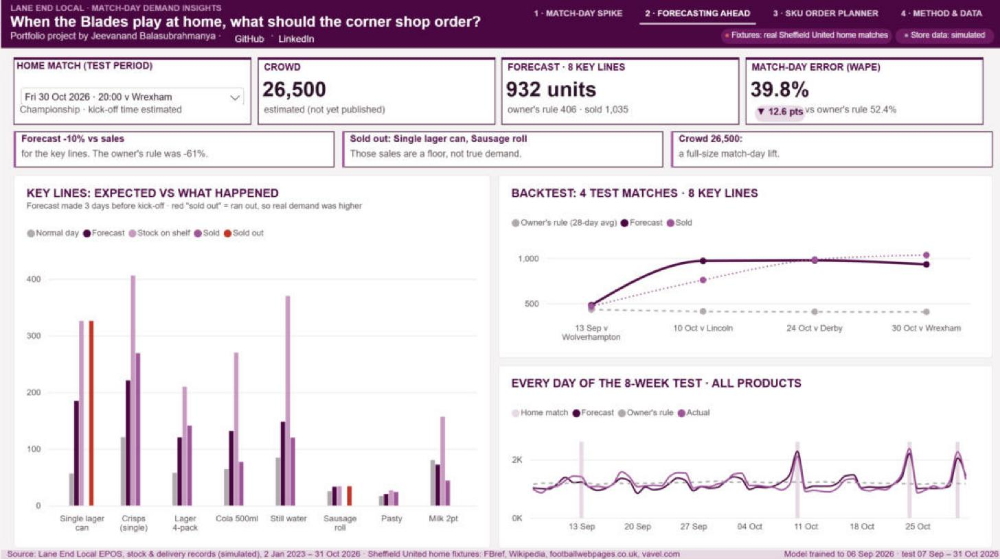
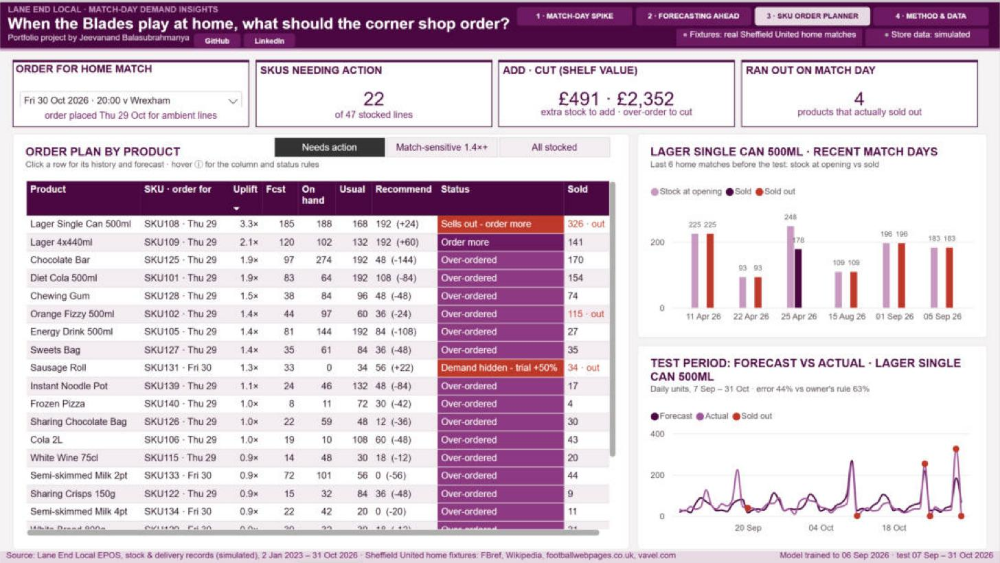
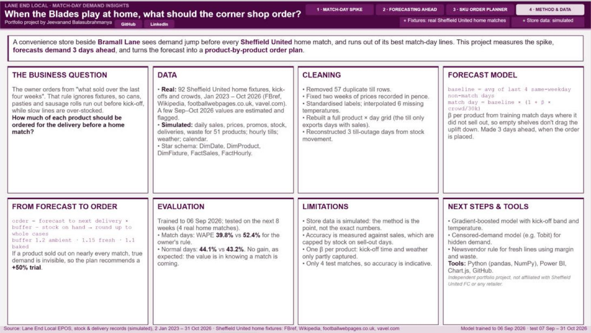

# When the Blades play at home, what should the corner shop order?

**Match-day demand forecasting for Lane End Local, a (fictional) convenience store next to Bramall Lane, Sheffield.**
Power BI report + interactive HTML version · portfolio project by Jeevanand Balasubrahmanya · [GitHub](https://github.com/JeevanandB) · [LinkedIn](https://www.linkedin.com/in/jeevanand-balasubrahmanya/)

👉 **Live interactive dashboard:** https://jeevanandb.github.io/LaneEndLocal-matchday-forecast/ (source: [`docs/index.html`](docs/index.html), served with GitHub Pages)

> **Data honesty:** the store data (sales, stock, prices, promotions, weather) is **simulated**. The Sheffield United home fixtures, kick-off times and crowds are **real** public data from FBref, Wikipedia, footballwebpages.co.uk and vavel.com. Every report page says so. This is an independent portfolio project, not affiliated with Sheffield United FC or any retailer.

---

## The business question

A corner shop beside Bramall Lane sees demand jump before every Sheffield United home match. The owner orders from "what sold over the last four weeks", a rule that ignores fixtures entirely. So cans, pasties and sausage rolls run out before kick-off, while slow lines sit over-stocked.

I wanted to answer one practical question: **how much of each product should be ordered for the delivery before a home match?**

To get there, I:
1. measured the match-day spike (when it happens and which products it hits),
2. forecast demand 3 days ahead (when the order is actually placed), and
3. turned that forecast into a product-by-product order plan.

## The data

| Table | What it holds |
|---|---|
| `DimDate` | One row per day, 2 Jan 2023 – 31 Oct 2026: weekday, bank holidays, uni term, opening hours, weather, match details, Train/Test flag |
| `DimProduct` | 51 SKUs: name, category, price, cost, shelf life, case size, delivery schedule |
| `DimFixture` | 92 real Sheffield United home matches with source flags |
| `FactSales` | Product × open day: units, prices, promos, revenue, stock, deliveries, waste, stock-outs |
| `FactHourly` | Store-level till totals by hour |
| `SkuMatchUplift` | Per SKU: match-day uplift, sell-out rate, whether demand is hidden by sell-outs |
| `FactForecast` | Test period, product × day: my forecast, two naive benchmarks, actuals |
| `FactOrderPlan` | For each test match, per SKU: stock on hand, the owner's usual order, my recommended order and status |

- **Real:** the fixtures, kick-offs and crowds. A few Sep–Oct 2026 kick-off times and attendances weren't published yet, so they are estimated and flagged in the data and on the report.
- **Simulated:** everything to do with the shop. I generated it to behave like a real convenience store, including sell-outs and the kind of glitches you get in a real till export.

## Cleaning

- Removed 57 duplicate till rows.
- Fixed two weeks of prices recorded in pence instead of pounds (corrected from revenue).
- Standardised product and category labels; interpolated 6 missing temperatures.
- Rebuilt a full product × day grid, because the till only exports days with sales (zero-sales days matter for forecasting).
- Reconstructed 3 till-outage days from stock movement.
- In Power BI: typed all date columns as dates (they had loaded as Excel serial numbers), built a star schema with single-direction relationships, turned off auto date/time, and added a `DimHour` table and a sorted weekday column.

## The forecast model

```
baseline  = average of the last 4 same-weekday non-match days (known 3 days ahead)
match day = baseline × (1 + β × crowd / 30,000)
```

I estimated β for each product from training match days **where it did not sell out**. On sell-out days sales stop at the stock level, so including them would drag the uplift down. The forecast is made 3 days before kick-off, when the order is placed. The model was trained on data up to 6 Sep 2026 and tested on the next 8 weeks (7 Sep – 31 Oct 2026), which included 4 real home matches.

## The order rule

```
order = forecast until the next delivery × buffer − stock on hand → round up to whole cases
buffer: 1.2 ambient (Mon & Thu deliveries) · 1.15 fresh (daily) · 1.1 baked
```

If a product sold out on nearly every match day, its true demand can't be seen in the data, so the plan recommends a **+50% trial** rather than trusting the measured uplift. Each line gets a status: *Order more*, *Over-ordered*, *Sells out – order more*, *Demand hidden – trial +50%* or *OK*.

## Results

| | My model | Owner's rule (28-day avg) | Same day last week |
|---|---|---|---|
| **WAPE, match days** | **39.8%** | 52.4% | 56.4% |
| WAPE, normal days | 44.1% | 43.2% | – |

- On match days the forecast cuts the error by **12.6 percentage points** against the owner's rule, with a slight under-forecast (bias −4.9%).
- On normal days there's **no gain**, and I didn't expect one: the value is in knowing a match is coming.
- On a typical 3pm Saturday home match the shop takes **£5,157** against **£3,462** on a normal Saturday (+49%), with **701** transactions against 524 (+34%). The busiest hour is **13:00**, at **£1,017**, about 4.2× the same hour on a normal Saturday.
- For the 30 Oct match against Wrexham, the planner flags **22 of 47 lines**: about **£491** of extra stock to add and **£2,352** of over-ordering to cut. Under the owner's actual order, 4 products ran out.

## Limitations and next steps

**Limitations**
- The store data is simulated, so the method is the point, not the exact numbers.
- Accuracy is measured against sales, which are capped by stock on sell-out days.
- One β per product: kick-off time and weather are only partly captured.
- Only 4 test matches, so the accuracy figures are indicative.

**Next steps**
- A gradient-boosted model with kick-off band and temperature.
- A censored-demand model (e.g. Tobit) for products whose demand is hidden by sell-outs.
- A newsvendor rule for fresh lines that balances margin against waste.

**Tools:** Python (pandas, NumPy), Power BI (PBIP/TMDL/PBIR, DAX), Chart.js, GitHub.

## The report

| Page | What it shows |
|---|---|
|  | **1 · Match-day spike:** revenue by hour, match day against the same weekday with no match (filter by kick-off band), and which products jump on match day |
|  | **2 · Forecasting ahead:** pick a test match to see the forecast for the 8 key lines against what was on the shelf and what sold, plus the backtest and every day of the test period |
|  | **3 · SKU order planner:** the recommended order for each product against the owner's usual order, with each product's recent match-day history |
|  | **4 · Method & data:** the business question, data, cleaning, model, order rule, evaluation, limitations and next steps |

Every KPI, chart and table has an ⓘ help tooltip in its visual header that explains what it shows.

## Running it yourself

```
/pbip/        Power BI project (open pbip/United.pbip in Power BI Desktop)
/data/        LaneEndLocal_PowerBI_Data.xlsx (the README sheet describes every table)
/docs/        index.html (the interactive HTML version) and screenshots
```

1. Open `pbip/United.pbip` in Power BI Desktop. The data cache isn't in the repo, so the tables start empty.
2. Go to **Home → Transform data → Edit parameters**. Set **`DataFile`** to the **full path** of `data\LaneEndLocal_PowerBI_Data.xlsx` in your clone, e.g. `C:\Projects\LaneEndLocal-matchday-forecast\data\LaneEndLocal_PowerBI_Data.xlsx`.
   In the repo, `DataFile` holds the repo-relative path `..\data\LaneEndLocal_PowerBI_Data.xlsx` as a reminder of where the file lives. Power Query's `File.Contents` needs an absolute path, and every query reads the workbook through this one parameter, so this is the only value you need to change.
3. Click **Refresh**.
